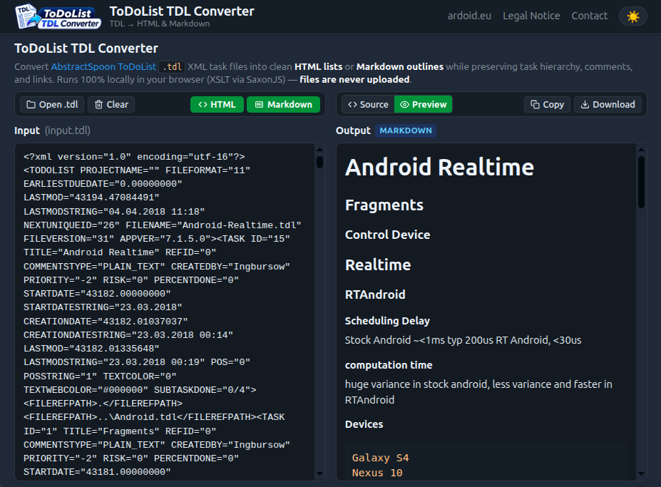

# ToDoList TDL Converter

[](LICENSE.md)
[](https://ardoid.eu/tdlconverter/)
[](https://www.w3.org/TR/xslt-30/)
[](https://www.saxonica.com/saxonjs/)

A fast, client-side web and CLI converter for [AbstractSpoon ToDoList](https://www.abstractspoon.com/) `.tdl` files. Converts task hierarchies, comments, and file links into clean **HTML** lists or **Markdown** outlines.

🌐 **Try the online tool:** **<https://ardoid.eu/tdlconverter/>**

---



---

## Features

- 🔒 **100% Client-Side & Private:** All conversions execute entirely inside your browser via [SaxonJS](https://www.saxonica.com/saxonjs/). Your `.tdl` files are **never uploaded** to any server.
- 🌳 **Hierarchy Preservation:** Keeps parent/child task nesting intact.
- 📝 **Rich Task Metadata:** Formats task titles, task comments (`<p>`), and file hyperlinks (`FILEREFPATH`).
- 🌓 **Dual View & Themes:**
  - **Source View:** Editable raw HTML / Markdown output with instant live preview synchronization.
  - **Preview View:** Formatted visual preview that adapts to Light and Dark themes.
- 📋 **Easy Export:** One-click **Copy to clipboard** and **Download** as `.html` or `.md`.
- 🔤 **Encoding Auto-Detection:** Seamlessly reads UTF-8 as well as Windows UTF-16 (LE and BE with BOM).
- 💻 **CLI Mode:** Includes `run.sh` to batch-convert files using Java Saxon-HE.

---

## Supported Conversions

| Format | Stylesheet | Output Description |
|---|---|---|
| **HTML** | `tdl2html.xsl` | Hierarchical nested `<ul>`/`<li>` structure with task titles, comment blocks, and clickable links. |
| **Markdown** | `tdl2md.xsl` | Structured outline with headings, task metadata, and indented notes. |

A sample task list is included at [`docs/Bindungen.tdl`](docs/Bindungen.tdl) for quick testing.

---

## Web App Usage

1. Open **<https://ardoid.eu/tdlconverter/>** in any modern web browser.
2. Load your `.tdl` file by:
   - Clicking **Open .tdl**,
   - Dragging & dropping the file onto the **Input** pane, or
   - Pasting the raw XML directly into the text area.
3. Click **HTML** or **Markdown**.
4. Review the result in **Source** (editable) or **Preview** mode.
5. Click **Copy** or **Download**.

---

## Command Line Usage (CLI)

You can also run transformations offline on the command line using Java and Saxon HE.

### Requirements

- Java Runtime Environment (JRE 8+)
- [Saxon-HE](https://www.saxonica.com/download/java.xml) (`.jar`)

### Instructions

1. Set the path to your Saxon-HE JAR file:
   ```bash
   export SAXON_JAR=/path/to/saxon-he-12.jar
   ```

2. Run `./run.sh` with the input file, stylesheet name, and output file:

   **Convert to HTML:**
   ```bash
   ./run.sh input.tdl tdl2html.xsl output.html
   ```

   **Convert to Markdown:**
   ```bash
   ./run.sh input.tdl tdl2md.xsl output.md
   ```

   Run `./run.sh --help` for full parameter options.

---

## Development & Build

### Prerequisites

- [Node.js](https://nodejs.org/) (v16+) and `npm`

### Setup

```bash
git clone https://github.com/ksowada/TDL-Converter.git
cd TDL-Converter
npm install
```

### Available Scripts

- **`npm run build`**: Compiles the XSL stylesheets into optimized SaxonJS SEF JSON files (`xslt3`) and packages the web application into `dist/`.
- **`npm run serve`**: Starts a local development server on `http://localhost:8000`.
- **`npm run serve:dist`**: Previews the production-ready `dist/` bundle locally.

### Web Deployment (Manual FTP)

After running `npm run build`, upload the generated contents of the `dist/` directory to your web server (e.g. into `/tdlconverter/` on your host) using any FTP/SFTP client (such as FileZilla, Cyberduck, or lftp).

---

## Project Structure

```
├── app.js               # Application logic, event wiring, and theme management
├── index.html           # Main user interface and SEO metadata
├── style.css            # Responsive layout, themes, and viewport management
├── logo.webp            # Application logo
├── tdl2html.xsl         # XSLT 1.0/3.0 stylesheet for HTML conversion
├── tdl2md.xsl           # XSLT 3.0 stylesheet for Markdown conversion
├── run.sh               # CLI transformation helper using Saxon-HE (Java)
├── package.json         # Build dependencies and npm scripts
├── saxonjs3/            # SaxonJS 3 runtime libraries
├── scripts/
│   └── build.sh         # Production build script (compiles SEF & populates dist/)
└── docs/
    ├── Bindungen.tdl    # Sample ToDoList file for testing
    └── Screenshot.png   # Application screenshot
```

---

## Privacy Notice

This application processes all data client-side inside the user's browser. No task titles, comments, file paths, or documents are transmitted over the network or saved on any server.

---

## License

This project is licensed under the [MIT License](LICENSE.md).

### Third-Party Software

- **[SaxonJS](https://www.saxonica.com/saxonjs/):** © Saxonica Ltd. Distributed for runtime transformation under Saxonica's license (see [`saxonjs3/LICENSE.txt`](saxonjs3/LICENSE.txt)).
- **[marked](https://github.com/markedjs/marked):** Markdown parser for browser preview.
- **[water.css](https://watercss.kognise.dev/):** Base styling foundation.
